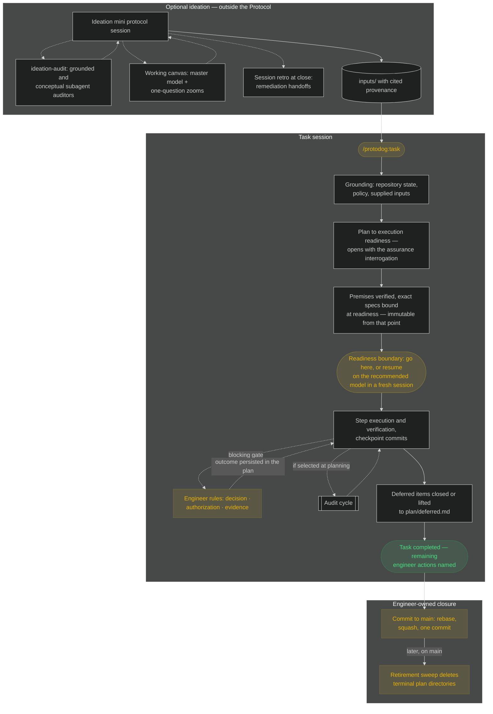
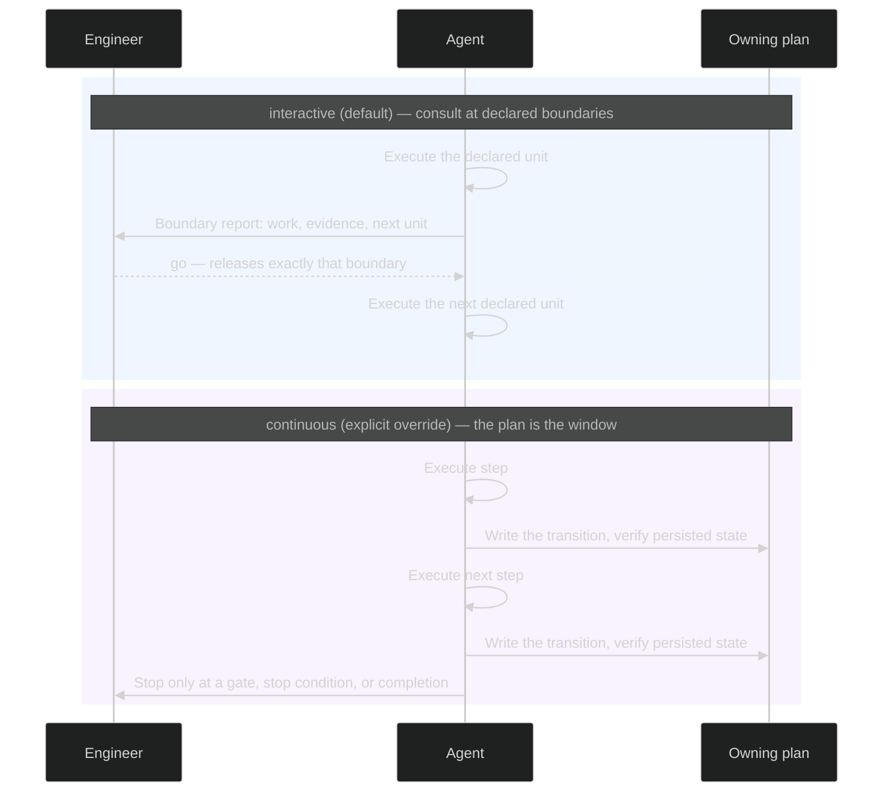
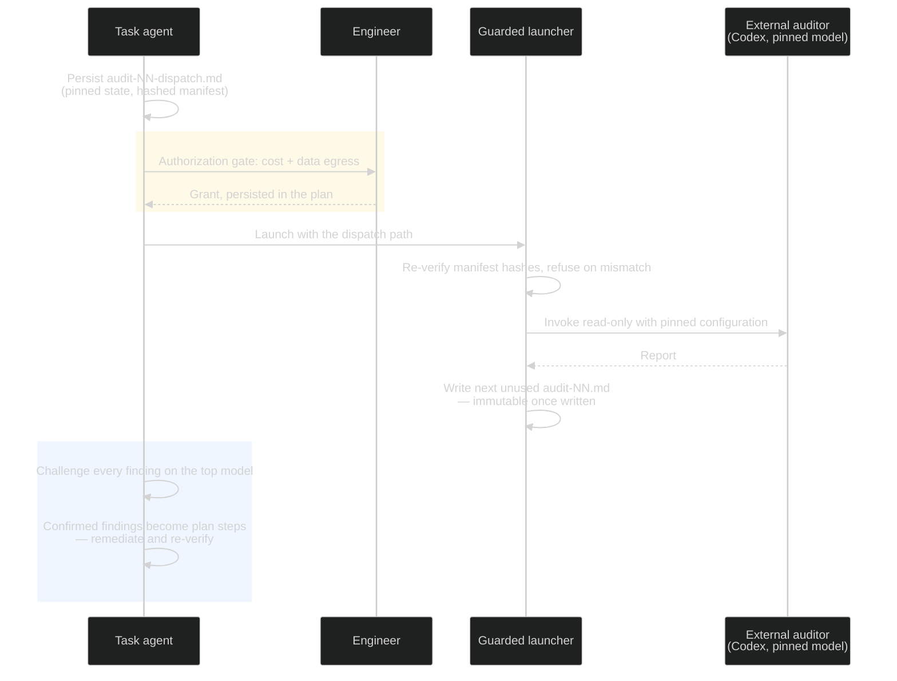
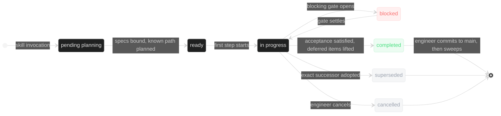

# Protodog

## What this is

Protodog is an execution protocol for agent-assisted engineering: one engineer's working
methodology encoded as installable machinery for Claude Code and local Codex — skills as entry points, hooks and
validators as enforcement, Markdown artifacts in the repository as the only execution state. It
does not orchestrate models or generate code; it constrains how delegated work enters,
progresses, and reaches `main`, so every session runs under the same contract instead of whatever
the model woke up believing.

The concepts, in one pass. The engineer enters the **Task profile** — a bounded objective, one
agent — never the protocol itself. Context
moves through a provenance chain: `inputs/` (unvalidated material, including anything an external
model produced), `specs/` (reconciled intent, premises verified against the repository, immutable
once a plan binds it), `plan/` (live
state — steps, acceptance criteria, gates, decisions, all under stable IDs). **Gates** are the
human-in-the-loop core — decision, authorization, evidence — and authority is explicit:
model capability, tool access, and prior success never create permission. **Cadence** —
`interactive` by default, `continuous` by explicit override — sets how often the engineer is
consulted, and changes nothing else. **Assurance** scales
with risk, and an audit means independent, adversarial, and undirected within scope — executed
by a different vendor's model through a hash-pinned read-only launcher, never by the author
grading itself.

The discipline is mechanical wherever it can be: hooks deny engineer-owned Git (push, fetch,
rebase, history rewrites, `main`); validators reject malformed plans, marker/status drift,
unmapped acceptance, edits to bound specs or audit reports, terminal plans still carrying live
obligations or unsettled acceptance, and lifts whose destination row does not exist. Enforcement
sits at the host's Write, Edit, and Bash tools: shell commands are checked after they run against
a snapshot of `plan/` and `specs/`, ids are held stable against HEAD once execution begins, and a new register id may not collide with one already landed on `origin/main`. Prose is reserved for judgment. Git is a split contract — the agent checkpoints
freely inside its managed worktree, the engineer owns the commit to main, and one Task, or a
declared line of Tasks, reaches `main` as exactly one commit. Plans die on schedule: obligations close or lift to
a register, committed directories are swept, Git history is the archive.

What that buys: no per-session variance in how delegation works; no silent agent overreach; no
state rotting in chat scrollback — resumption is the plan plus the repository, nothing else; no
"done" without evidence — acceptance maps to checks, and a pass cannot be manufactured by
weakening one; no self-graded review; contained Git blast radius; no plan archaeology — the
working tree carries only what still decides something.

This file is the install and operations guide; the normative authority is `protodog/core/`, and
this README never overrides it.

## Contents

- [What this is](#what-this-is)
- [Prerequisites](#prerequisites)
- [Install](#install)
- [Release ritual](#release-ritual)
- [Verify](#verify)
- [Use](#use)
- [Notes](#notes)

## Prerequisites

- .NET SDK ≥ 10 (hooks, validators, and the audit launcher are file-based apps; no packages, no Node)
- bash, git
- Claude Code or local Codex CLI/desktop for Task execution
- An authenticated opposite-vendor CLI when an independent audit is selected: Codex for Claude
  execution, Claude Code for Codex execution

The Codex adapter targets local tool execution (tested against CLI 0.163.0 hook payloads).
The Claude audit backend uses the `--safe-mode` and restricted-tool CLI surface available in
Claude Code 2.1.304. Older clients must be checked for those flags before use. Concurrent writer
support remains Claude-only.

## Install

### Claude Code

Once per engineer — the plugin follows you across repositories. This repository is a Claude Code
plugin marketplace (`kennel`) serving the `protodog` plugin. In Claude Code:

```text
/plugin marketplace add <path-or-git-url-of-this-repo>
/plugin install protodog@kennel
```

That single install gives every repository you open the skills, the pinned challenge agent type,
and the enforcement hooks — no per-repo copies, no settings merges. Per-repo opt-out: `/plugin disable protodog@kennel` in
that project. (`protodog/hooks/settings-fragment.json` remains only as the wiring fallback for a
repository that vendors `protodog/` directly.)

### Codex

Build a self-contained local marketplace from the same core, validators, and skills. The output
must be a new directory; use a new versioned destination when updating. Generated packages are
not maintained source copies. From this repository:

```bash
dotnet protodog/scripts/build-codex-package.cs dist/codex-4.1.0
codex plugin marketplace add ./dist/codex-4.1.0
codex plugin add protodog@kennel-codex
```

Restart Codex and open `/hooks` to review and trust Protodog's hook definitions. Installing the
plugin alone does not activate untrusted hooks. Use `/skills` to select the installed Task
skill, or invoke `$protodog:task` with intent or `plan: @plan/<plan-id>/task-plan.md`. The package exposes
Task, plan-sweep, deferred-review, working-canvas, the ideation mini protocols, runbook, persist,
interrogate, and commit-message — on Codex their argument is the invocation text, with no
substitution and no shell injection; it does not expose ideation-audit or coordinate.
Keep the generated marketplace available while it is registered. To update, remove the old
`kennel-codex` marketplace registration, register the new build, reinstall the plugin, restart,
and review changed hooks. The source Claude package and its install flow are unchanged.

The coordinator is the only writer. Planning/challenge model settings live in
`protodog/agents/challenge-codex.toml`; a lower-tier session hands off to a new coordinating
session for challenge/remediation. This file is routing data loaded by the skill, not an
automatically installed Codex custom agent. Host mechanics are normative in
`protodog/core/host-runtime.md`. An explicit `no commits` instruction is retained on resumption
and overrides checkpoint commits.

**Installation smoke check.** In a disposable repository, start a fresh Codex Task, complete
planning, and confirm it stops at readiness even with `cadence: continuous`. Resume the ready
plan in a fresh session and release it with `go`. Confirm position output comes from the
validator. In that disposable repository, ask for a patch to a bound spec and confirm the
pre-tool hook blocks it; a deliberately invalid plan must produce post-tool validation feedback.
Repair it before proceeding. Hook feedback is detection after a completed write, not rollback.
Repeat with `no commits` and verify HEAD does not change. These host/model interaction checks
complement the deterministic test suite; the suite does not prove model adherence or hook trust
in a particular installation.

Codex audits use Claude with only Read/Glob/Grep, no shell, editing, MCP servers, skills, or
user/project customizations. The launcher captures JSON results and records the resolved model
when supplied. Shell-based inspection and test execution are outside that auditor's coverage.
The ordinary per-audit authorization gate still applies. No model calls occur during package
building or the automated tests.

Runtime references: [Codex hooks](https://learn.chatgpt.com/docs/hooks),
[plugin packaging](https://developers.openai.com/plugins/build/plugins), and
[subagent permissions and model configuration](https://learn.chatgpt.com/docs/agent-configuration/subagents).

### Editor prompts

Per-engineer, editor-level (optional): `prompt-utility.code-snippets` holds the prompts that live
in the editor — composition fragments, guardrail lines, the selection-based prompt improver, the
audits, and the session retro — as a personal, repo-agnostic registry; prompts invoked from an
agent host are skills, and each prompt exists in one form only. Install once at the VS Code user
level, symlinked so this repo stays the single canonical source:

```bash
ln -s "$(pwd)/protodog/registries/prompt-utility.code-snippets" \
  "$HOME/Library/Application Support/Code/User/snippets/prompt-utility.code-snippets"
```

`boxer.code-snippets` is a declared project family: copy it into the `.vscode/` of the BoxerUI
repositories that use it, nowhere else.

## Release ritual

Change → the Verify suites green → optional release audit over the delta since the last audited
state, through the guarded launcher, challenged and remediated on the branch → bump
`protodog/.claude-plugin/plugin.json` version → `CHANGELOG.md` entry → one commit to `main` →
rebuild the Codex package to `dist/codex-<version>`. Both hosts update from their own CLI, and a
session asked to release closes by naming the commands: Claude Code `/plugin marketplace update
kennel` then `/plugin update protodog`; Codex `codex plugin marketplace add ./dist/codex-<version>`
then `codex plugin add protodog@kennel-codex`, after removing the old `kennel-codex` registration,
then restart and review changed hooks. Protocol changes to this repository ship as
engineer-reviewed release commits; a heavier change may run under Protodog itself (plans under
`plan/`, specs under `specs/`).

## Verify

```bash
./protodog/validators/test-validators.sh   # plan/spec/register validation
./protodog/validators/test-registry.sh     # snippet registries
./protodog/hooks/test-hooks.sh             # enforcement fences (incl. plugin-mode resolution)
./protodog/scripts/test-audit-launch.sh    # launcher gates (dry-run, no Codex contact)
./protodog/scripts/test-sweep-check.sh     # retirement sweep-safety checker
./protodog/scripts/test-worktree-survey.sh # worktree retirement survey (report-only)
bash ./protodog/scripts/test-codex.sh      # Codex payloads, Task lifecycle, fake Claude, relocated package
```

CI runs these suites plus manifest checks on every push (macOS runner: the test drivers
use BSD sed).

## Use

### Ideate, then enter

Ideation is optional and happens outside the Protocol — in either host, by invoking a mini
protocol with your context as the argument: `/protodog:ideate-feature` (repository-grounded work
shaping, ending in blast-radius and Task sizing), `/protodog:ideate-concept` (pure conceptual —
approaches, abstractions, no repository required), or `/protodog:ideate-domain` (domain modeling).
Whenever you ask to be interrogated, `/protodog:interrogate` puts the open choices to you as
structured questions, recommendation first and default stated; `/protodog:persist @inputs/…`
saves the conclusions with provenance when you say so.
Inside a Claude ideation session, `/protodog:ideation-audit` dispatches fresh-context adversarial
subagent audits — grounded in the repository and/or purely conceptual — of the session's settled
conclusions, so design concepts and logic are settled while they are still cheap to change.
For diagram-suited subjects — structure mappings, topologies, lifecycles, data flows —
`/protodog:working-canvas` keeps a working canvas from the baseline turn: one master model in
concern lanes plus one-question zooms, alternatives sketched in context before the prose
comparison, recolored at settlement and audit reconciliation, promotable at close. The same
doctrine follows work into the profile — a gate in a diagram-suited domain presents its options
drawn in context, and execution recolors built work — with the canvas always a working view,
never state.
A heavy session can close with `p-protocol-retro` — a retrospective surfacing churn and dragged
uncertainties while they are fresh, shaping remediations as handoffs.
`/protodog:runbook` cuts the visible session, or an explicit ideation handoff, register cluster,
or audit reconciliation, into a dated sequence of Tasks. It reconciles settled decisions and
corrections, inspects repository HEAD, reuses your settled landing policy or asks you to choose,
and names prerequisites on `main` or a declared line's branch. Each unit carries exclusive write
boundaries, verification, host-relative execution tiers, any host/model preferences you supplied,
assurance recommendations, and dispatch prompts for both hosts with enough source context for a
fresh session. The runbook names how the combined objective is proven and is re-issued from
repository and plan evidence as the sequence changes. Drafting needs no saved handoff and creates
no files by default; ideation results enter Protocol planning only as `inputs/` documents with
cited provenance, saved on explicit instruction. Before the sequence it settles the standing
rulings once — landing policy, cadence, surface grants, assurance, paid runs — and carries each
into the affected dispatch as the Task skill's overrides (`cadence:`, `authority:`,
`assurance:`); tiers follow the routing ladder with a stated confidence.

Dispatch by hand, one fresh session per unit, or from one session with
`/protodog:coordinate [units: …]`: it runs the eligible units as isolated-worktree subagents on
their rungs, rules within the standing rulings, batches every other gate into one interrogation,
re-issues the runbook on evidence or on your instruction (add a unit, add an audit), and routes
each landed unit's deferred items to the downstream unit that owns their surface. Landing on
`main` stays yours. Coordination is one dispatch option, Claude Code only, and dispatches only
the subset you name.

### One session, one Task

Start with `/protodog:task` in Claude Code or `$protodog:task` in Codex; supply intent or exact
`@inputs/` / `@specs/` references. Artifacts live under `inputs/`,
`specs/`, and `plan/<plan-id>/` of the repository you're in, per `protodog/core/foundation.md`.
Start the session on the model you want planning to run on — planning through execution readiness
belongs on the top tier, where binding immutability amplifies judgment error — and the readiness
boundary pauses in every cadence: it recommends the execution model the planned steps actually
need under the routing ladder — never the small tier, the next rung up when confidence is low —
with driving signals, confidence, and what would flip the tier, and hands you the exact invocation
to resume in a fresh session on it, or `go` continues in place.
Yellow below marks the engineer-owned moments; everything else is delegated agent work.



### Cadence

Cadence governs how often the engineer is consulted — nothing else. It never changes authority,
verification, or who commits; checkpoints happen at coherent verified units in either mode.

- **`interactive`** (default): proceed to the declared boundary — the first one normally a small,
  reversible, independently verified unit — report completed work, material evidence, and the
  next unit, then wait. Every report opens with the position line the validator computes from
  the plan (`validate-plan.cs --position`): status, work done over total, active and blocked
  rows, open gates, acceptance, next boundary. `go` releases exactly the declared boundary and
  changes nothing else.
- **`continuous`** (explicit override, at invocation or any time): proceed through unambiguous
  planned work until a gate, a stop condition, a required engineer action, or completion. With no
  boundary reports, the plan is the engineer's only window — every status transition writes the
  owning plan and verifies the persisted state before dependent work proceeds, and each
  checkpoint commit carries the position line so the log reads as progress.
- Cadence is Task-wide. The engineer may intervene at any time, and in neither cadence are
  grounding, planning, or plan revision approval stops.



### Audit cycle

Audits and paid evaluation runs are scheduled at planning time: Task planning opens with the
assurance interrogation, so scheduling leaves planning as
settled state (a selected instrument with its placement or bounds, a gate for ruling, or an
explicit not-scheduled decision) instead of lingering uncertainty. When execution reaches the
declared placement, the agent
persists the self-contained dispatch pinning the exact state, and launch waits on an
authorization gate — cost plus data egress, since repository content leaves the boundary:

```bash
dotnet protodog/scripts/audit-launch.cs plan/<plan-id>/audits/audit-NN-dispatch.md
# From a Codex Task, select its cross-vendor backend:
dotnet protodog/scripts/audit-launch.cs --auditor claude plan/<plan-id>/audits/audit-NN-dispatch.md
```

`--dry-run` (before `--auditor`, when supplied) checks the launcher's argument, report, and manifest
guards without contacting either service; the authorization grant remains a Protocol gate, not
something the launcher infers. Reports are immutable; a re-launch is a
new numbered cycle, and the challenge must address every report on file. Between launch and
report capture the manifested files are frozen (a prose rule: the launcher re-verifies the
manifest after capture and stamps any drift into the report) — plan updates that would touch them queue and
flush after capture.



### Plan state and retirement

A plan cannot go terminal while it is the sole carrier of a live obligation: deferred issues and
accepted gaps lift to `plan/deferred.md` (template `protodog/templates/deferred-register.md`,
validated on write) or record their closure through disposition arrows (enforced) — a judgment
call, never a reflex move to the register. Deferral is itself classified, not residual: a finding
that passes the Foundation's fix-now test becomes a step, and a lifted deferred issue carries the
reason tag it failed on (`defer: out-of-scope | needs-decision | cost | blocked-by`, enforced). Terminal plan directories already on `main` are then
deleted by the engineer-triggered retirement sweep — Git history on `main` is the archive, which
the one-commit rule guarantees.



### Maintenance

Two engineer-invoked skills keep `plan/` honest. `/protodog:plan-sweep` is the retirement sweep:
a deterministic checker proves terminal + lifted + committed for every entry
(`dotnet protodog/scripts/sweep-check.cs`, usable standalone as the plan-tree survey), classifies
every file under `specs/` and `inputs/` as live, retiring with a sweepable plan, retirable,
backlog (never consumed by any plan), or blocked, by citation and history, the skill
adds the one judgment step — citation liveness — and deletes only what you confirm, as one sweep
commit. The survey is the backlog view: live plans, parked rows, and backlog inputs. `dotnet protodog/scripts/worktree-survey.cs [<repo-root>] [--base <ref>]` surveys the
repository's worktrees the same way — merged and clean proven, dirty paths, detached heads,
unpublished branches, ignored files and matching plan directories listed as judgment — and prints
the removal commands for candidates without running them; cleanup stays yours.
`/protodog:deferred-review` hunts register drift: it verifies every parked row against
current repository state (closed by later work? trigger fired? claim still reproduces?) and
applies only the transitions you ratify. Run it at the landing moment — after your rebase onto
`main` and before the commit to main, in a fresh session — where the register is current; Task
completion names that moment and never runs the review itself. Beside its transitions the review
proposes **clusters**: for a row being picked up, the parked rows that share its code surface or
its trigger and its verification, one reason line per member and per excluded row, ratified as
one request you strike members from, and adopted by the next Task as steps. The review lifts no
rows of its own; a defect it finds without one goes to the Task that adopts the cluster. The
survey is a command, not a document — there is no index artifact to maintain. A deferred item
rarely needs the register while a runbook is live: a small finding on an adjacent surface becomes
a step on your surface grant (`authority:`) rather than a superseding spec, and an item another
live plan adopts closes as carried by it; the register keeps what no unit owns.

`/protodog:commit-message` proposes one line for the staged changes in your own style and
commits nothing.

For a large register, use a cheaper model for a bounded first pass, then select a stronger model
in a fresh session for focused verification. Both hosts use the same skill and handoff format:

| Stage | Claude Code | Codex |
|---|---|---|
| Triage | `/protodog:deferred-review triage` | `$protodog:deferred-review triage` |
| Verify | `/protodog:deferred-review verify <handoff-path>` | `$protodog:deferred-review verify <handoff-path>` |

Triage accounts for every parked row as supported keep, possible transition, deeper investigation,
engineer/external evidence needed, or not assessed. It saves evidence and remaining questions to
`inputs/deferred-review/<unique-review-id>/triage.md`, leaves the register unchanged, and stops.
You can supply a destination and a time, token, or row budget; unfinished rows remain explicit.
The skill does not switch models or launch another host for you. No model family is pinned.

Verification checks the handoff against current repository state, investigates unresolved rows,
verifies transition candidates, and spot-checks supported keeps. It reports which evidence was
reused and what remains unresolved, then asks you to ratify proposed register changes. Saved
progress supports resumption without repeating still-current checks. These stages are directed
review, not an independent audit. Invoking `deferred-review` without a mode still performs the
ordinary full review. The staged procedure lives in
[the shared skill reference](protodog/skills/deferred-review/references/staged-review.md).

The change reaches Claude through a plugin update and Codex through a rebuilt and reinstalled
package using the installation steps above; existing installed copies do not change just because
the source was edited.

## Notes

- If hook invocation overhead matters, `dotnet publish protodog/hooks/protodog-hooks.cs`
  produces a native binary — point the hook commands at its output.
- Git boundary: the agent commits checkpoints inside its managed worktree; fetch/sync, rebase onto
  `main`, squash, the commit to main, cleanup, and plan retirement remain engineer-owned
  (`protodog/core/git-policy.md`).
- Hook denials log to `PROTOCOL_DENIAL_LOG` when set, else the plugin data directory
  (`CLAUDE_PLUGIN_DATA/protocol-denials.log`;
  repo-local fallback `protodog/logs/hook-denials.log`) — spikes after a model update signal
  protocol-fit regression; a hook that never fires is a deletion candidate.
- Provenance: extracted at v1.0.0 from the prototype workspace
  (`/Users/pablo/source/tmp/protocol`, commit `9ec6704`), which remains the frozen archive of the
  release-candidate lineage, AUDIT-01 cycle, and build history. Design rationale:
  `docs/design-rationale.md`.
